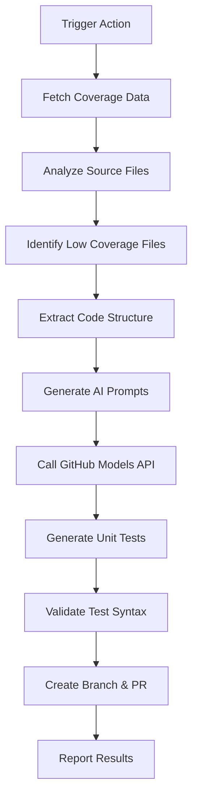

# GUTAI 🤖🧪

_Github Unit Test powered by AI_

A GitHub Action that automatically identifies files with low test coverage and generates comprehensive unit tests using AI. Boost your project's test coverage effortlessly with the power of GitHub Models!

[](https://github.com/marketplace/actions/gutai)
[](https://github.com/NaughtyIshmael/gutai/actions)
[](https://opensource.org/licenses/MIT)

## 🚀 Features

- **🔍 Smart Coverage Analysis**: Automatically fetches and analyzes test coverage from Codecov
- **🤖 AI-Powered Test Generation**: Uses GitHub Models to generate comprehensive, context-aware unit tests
- **📝 Smart PR Creation**: Auto-generates meaningful PR titles and commit messages based on code analysis
- **🎯 Intelligent Targeting**: Identifies and prioritizes files with the lowest test coverage
- **🌍 Multi-Language Support**: Generates unit tests for Python, Go, and Rust projects
- **📦 Zero Configuration**: Works out of the box with sensible defaults
- **🔄 Flexible Integration**: Use as a standalone action or integrate into existing workflows
- **📊 Detailed Reporting**: Provides comprehensive coverage analysis and test generation reports

## 📋 Quick Start

Add this action to your workflow:

```yaml
name: Boost Test Coverage
on:
  schedule:
    - cron: "0 2 * * 0" # Weekly on Sundays
  workflow_dispatch:

permissions:
  contents: write
  pull-requests: write
  models: read

jobs:
  boost-coverage:
    runs-on: ubuntu-latest
    steps:
      - name: Boost Test Coverage with GUTAI
        uses: NaughtyIshmael/gutai@v1
        with:
          codecov-token: ${{ secrets.CODECOV_TOKEN }}
          github-token: ${{ secrets.GITHUB_TOKEN }}
          max-files: 3
          target-coverage: 80
          create-pr: true
```

### Workflow permissions

For this action to work you must explicitly allow GitHub Actions to create pull requests. This setting can be found in a repository's settings under Actions > General > Workflow permissions.

For repositories belonging to an organization, this setting can be managed by admins in organization settings under Actions > General > Workflow permissions.

The workflow permissions should be set to `Read and write permissions` for the `contents` and `pull-requests` scopes, and `Read` for the `models` scope:

```yaml
permissions:
  contents: write
  pull-requests: write
  models: read
```

That's it! The action will:

1. 📊 Analyze your code coverage
2. 🎯 Identify files with low coverage
3. 🤖 Generate comprehensive unit tests using AI
4. 🔄 Create a pull request with the new tests

## 🛠️ Inputs

| Input              | Description                                                        | Required | Default               |
| ------------------ | ------------------------------------------------------------------ | -------- | --------------------- |
| `codecov-token`    | Codecov API token for fetching coverage data                       | No       | `''`                  |
| `github-token`     | GitHub token for API access and PR creation                        | Yes      | `${{ github.token }}` |
| `max-files`        | Maximum number of files to process                                 | No       | `3`                   |
| `target-coverage`  | Only process files below this coverage %                           | No       | `80`                  |
| `languages`        | Comma-separated list of languages to include (python,go,rust)      | No       | `auto-detect`         |
| `exclude-patterns` | Comma-separated glob patterns to exclude                           | No       | `test*,spec*,*_test*` |
| `test-framework`   | Preferred test framework (auto-detected if not specified)          | No       | `auto`                |
| `create-pr`        | Whether to create a pull request with generated tests              | No       | `true`                |
| `pr-title`         | Custom title for the pull request (auto-generated if not provided) | No       | `auto-generated`      |
| `branch`           | The PR branch name                                                 | No       | `coverage-boost`      |
| `ai-model`         | GitHub Models AI model to use                                      | No       | `openai/gpt-4.1-mini` |
| `output-format`    | Output format for test generation report                           | No       | `json`                |

## 📤 Outputs

| Output            | Description                                  |
| ----------------- | -------------------------------------------- |
| `files-processed` | Number of files that were processed          |
| `tests-generated` | Number of test files generated               |
| `coverage-report` | JSON report of coverage analysis             |
| `pr-url`          | URL of the created pull request (if created) |
| `branch-name`     | Name of the branch created with tests        |

## 📚 Usage Examples

### Basic Usage (Minimal Setup)

```yaml
permissions:
  models: read
  contents: write
  pull-requests: write

- name: Boost Test Coverage
  uses: NaughtyIshmael/gutai@v1
  with:
    github-token: ${{ secrets.GITHUB_TOKEN }}
```

### Advanced Configuration

```yaml
permissions:
  models: read
  contents: write
  pull-requests: write

- name: Advanced Coverage Boost
  uses: NaughtyIshmael/gutai@v1
  with:
    codecov-token: ${{ secrets.CODECOV_TOKEN }}
    github-token: ${{ secrets.GITHUB_TOKEN }}
    max-files: 5
    target-coverage: 75
    languages: "python,go,rust"
    exclude-patterns: "migrations/*,vendor/*,node_modules/*"
    test-framework: "pytest"
    ai-model: "openai/gpt-4.1-mini"
    pr-title: "Improve test coverage for core modules"
    branch-prefix: "coverage-improvement"
```

## 🎯 Supported Languages & Frameworks

GUTAI currently supports unit test generation for the following languages:

| Language   | Test Frameworks    | Coverage Tools          | Status       |
| ---------- | ------------------ | ----------------------- | ------------ |
| **Python** | pytest, unittest   | coverage.py, pytest-cov | ✅ Supported |
| **Go**     | testing (built-in) | go test -cover          | ✅ Supported |
| **Rust**   | cargo test         | tarpaulin, grcov        | ✅ Supported |

### Language Support Notes

- **Python**: Full support for pytest and unittest frameworks with comprehensive test generation
- **Go**: Native support for Go's built-in testing package with proper test file structure
- **Rust**: Support for Cargo's test framework with unit and integration test generation

Other languages are detected for coverage analysis but unit test generation is only available for Python, Go, and Rust projects.

## 🔧 Prerequisites

### Required Setup

1. **Codecov Integration**: Your repository should upload coverage reports to [Codecov](https://codecov.io), and provide a valid Codecov token via the `codecov-token` input.
2. **Supported Languages**: GUTAI generates unit tests for Python, Go, and Rust projects. Other languages are analyzed for coverage but tests are not generated.
3. **GitHub Token**: The action needs a GitHub token with appropriate permissions which can be provided via the `github-token` input. This token is used to create pull requests and access the GitHub Models API.
4. **GitHub Token**: The action needs a GitHub token with appropriate permissions which can be provided via the `github-token` input. This token is used to create pull requests and access the GitHub Models API.
   - With `GITHUB_TOKEN` in `${{ secrets.GITHUB_TOKEN }}`, the created PR will not trigger new workflows as limited by Github.
   - If you want to trigger workflows from the created PR, create a personal access token and pass it via `github-token` input. You should ensure that it has the `repo` scope to allow the action to create pull requests and access the Models API.
5. **Repository Permissions**: [Enable proper permissions for GitHub Actions](#workflow-permissions).

## 📊 How It Works



### Step-by-Step Process

1. **📡 Coverage Analysis**: Fetches coverage data from Codecov API
2. **🔍 File Identification**: Identifies source files with coverage below the target threshold
3. **🧠 Code Analysis**: Analyzes code structure (functions, classes, methods)
4. **🤖 Test Generation**: Uses GitHub Models via AI Inference SDK to generate comprehensive test cases with contextually appropriate PR titles and commit messages
5. **✅ Validation**: Validates generated tests for syntax and basic structure
6. **🔄 Integration**: Creates a new branch and pull request with meaningful, auto-generated descriptions

## 🐛 Troubleshooting

### Common Issues

<details>
<summary><strong>❌ "No coverage data found"</strong></summary>

**Possible causes:**

- Repository doesn't upload coverage to Codecov
- Incorrect Codecov token
- Branch name mismatch

**Solutions:**

1. Verify coverage upload in your CI/CD pipeline
2. Check Codecov integration at https://app.codecov.io/gh/your-org/your-repo
3. Add `CODECOV_TOKEN` secret for private repos
</details>

<details>
<summary><strong>❌ "GitHub Models API error"</strong></summary>

**Possible causes:**

- Invalid GitHub token
- GitHub Models not available in your region
- Rate limiting

**Solutions:**

1. Verify `github-token` has correct permissions
2. Check GitHub Models availability
3. Use `gpt-4o-mini` for better rate limits
</details>

<details>
<summary><strong>❌ "No tests generated for my language"</strong></summary>

**Possible causes:**

- Language not supported for test generation
- Project structure not recognized

**Solutions:**

1. Verify your project uses Python, Go, or Rust (only supported languages)
2. Check that your project follows standard conventions for the language
3. Ensure source files are in expected locations (e.g., `src/` for Rust, `*.go` for Go)
4. Use `languages` input to explicitly specify: `python`, `go`, or `rust`
</details>

<details>
<summary><strong>❌ "Generated tests don't compile"</strong></summary>

**Possible causes:**

- Complex code structure
- Missing imports or dependencies
- Framework-specific conventions

**Solutions:**

1. Review and adjust generated tests manually
2. Specify `test-framework` input explicitly
3. Use `exclude-patterns` to skip complex files
</details>

### Debug Mode

Enable debug logging by setting `ACTIONS_STEP_DEBUG: true` in your workflow:

```yaml
env:
  ACTIONS_STEP_DEBUG: true
steps:
  - name: Boost Test Coverage (Debug)
    uses: NaughtyIshmael/gutai@v1
    # ... inputs
```

## 🤝 Contributing

We welcome contributions! Please see our [Contributing Guide](CONTRIBUTING.md) for details.

## 🧪 End-to-End Testing

GUTAI includes a comprehensive E2E test that validates the complete workflow:

```bash
# Run the full E2E test
python3 test_e2e.py

# Or use the convenience script
./run_e2e_test.sh

# With real GitHub Models integration
export GITHUB_TOKEN="your_token"
python3 test_e2e.py
```

The E2E test:

1. 📊 Runs pytest with coverage on sample code
2. 🔍 Identifies the least covered file
3. 🤖 Generates new tests using GitHub Models
4. ✅ Applies tests and validates they pass
5. 📈 Reports coverage improvement

See [E2E Testing Guide](docs/e2e-testing.md) for detailed information.

## 📄 License

This project is licensed under the MIT License - see the [LICENSE](LICENSE) file for details.

## 🙏 Acknowledgments

- [GitHub Models](https://github.com/marketplace/models-github) for AI-powered test generation
- [Codecov](https://codecov.io/) for coverage analysis
- [GitHub Actions](https://github.com/features/actions) for automation platform
- The open-source community for inspiration and feedback

## 📞 Support

- 📖 [Documentation](https://github.com/NaughtyIshmael/gutai/wiki)
- 🐛 [Issues](https://github.com/NaughtyIshmael/gutai/issues)
- 💬 [Discussions](https://github.com/NaughtyIshmael/gutai/discussions)

---

<div align="center">

**Made with ❤️ for the developer community**

⭐ Star this repo if it helped you boost your test coverage!

[Report Bug](https://github.com/NaughtyIshmael/gutai/issues) • [Request Feature](https://github.com/NaughtyIshmael/gutai/issues) • [Documentation](https://github.com/NaughtyIshmael/gutai/wiki)

</div>
